<!-- ===== BANNER PIXEL-ART ===== -->
<p align="center">
  
</p>

<!-- ===== TEXTO ANIMADO (fuente pixel) ===== -->
<p align="center">
  <a href="https://github.com/Julianv19">
    
  </a>
</p>

<p align="center">
  
  
</p>

---

## Sobre mí

```text
Desarrollador colombiano, 23 años, apasionado por la tecnología
Aprendiz SENA - Análisis y Desarrollo de Software (ADSO)
Enfocado en BACKEND (APIs REST) con conocimientos en FRONTEND (React + Tailwind)
Y habilidades en SQL / BASES DE DATOS (PostgreSQL + MySQL)
Trabajo constante, trabajo en equipo y mejora continua
Siempre aprendiendo y creciendo junto a un gran equipo
```

---

## Stack tecnológico

<b>Backend</b>
<p>
  
  
  
  
</p>

<b>Frontend</b>
<p>
  
  
  
  
  
</p>

<b>Bases de datos (SQL)</b>
<p>
  
  
  
</p>

<b>Herramientas</b>
<p>
  
  
  
  
  
</p>

---

## Proyectos destacados

<table>
  <tr>
    <td align="center" width="150"><b>Cafeterito</b></td>
    <td>
      Sistema de gestión para una cafetería: usuarios y permisos, inventario, menú,
      proveedores y órdenes, con <b>CRUD completo conectado a base de datos</b>.<br/>
      <sub>React · Node/Express · PostgreSQL · Tailwind</sub><br/>
      <a href="https://github.com/Nicolasecheverry22/3172293-cafeterito-project">Ver repositorio</a>
    </td>
  </tr>
</table>

---

## Mi actividad

<p align="center">
  
</p>

<p align="center">
  
  
</p>
<p align="center">
  
</p>

---

## Estadísticas

<p align="center">
  
  
</p>

<p align="center">
  
</p>

<p align="center">
  
</p>

---

## Contacto

<p align="center">
  <a href="https://www.linkedin.com/in/carlos-julian-ocampo-gonzalez-6b104a36a/">
    
  </a>
  <a href="mailto:julianocampov19@gmail.com">
    
  </a>
</p>

<p align="center"><sub>"El mejor código es el que se entiende y se mantiene."</sub></p>
